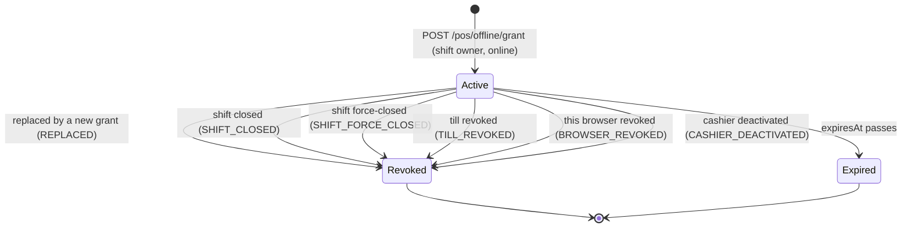

# Offline foundation: API contract (O3)

What the backend gives a POS till so it can keep selling through an outage of up to 6 hours: an **offline grant**, a **snapshot** of today's menu and settings, and a **status report** (heartbeat) that lets managers see unsynced sales and stops the day being closed too early. Offline selling and sync themselves are O4.

It builds on these contracts, which still apply:
- O1 resilience: `docs/2026-11-16-o1-resilience-api-contract.md`
- O2 tills, shifts and sessions: `docs/2026-11-17-o2-tills-shifts-api-contract.md`
- O2b receipt data: `docs/2026-11-17-o2b-receipt-data-api-contract.md`
- WS1-1b device registration: `docs/2026-11-13-device-registration-api-contract.md`

**Status:** implemented on `feature/o3-offline-foundation` (see `docs/2026-11-18-o3-offline-foundation-change-report.md`).

## Contents

1. Concepts
2. Settings
3. Shared rules: who may call the offline endpoints
4. Error codes
5. `POST /pos/offline/grant`
6. The grant's lifecycle
7. Offline numbering
8. `GET /pos/offline/snapshot`
9. `POST /pos/offline/status` (heartbeat)
10. Changed endpoints
11. Frontend checklist
12. Notes for O4
13. Decisions

## 1. Concepts

| Term | Meaning |
|---|---|
| **Offline** | The till can't reach the server. Only the POS till sells offline, for at most `maxOfflineHours` (6). |
| **Grant** | A signed permission, issued while online to the owner of the till's open shift. It says "this till may record sales offline for this shift and cashier until `expiresAt`". The till keeps it and sends it with each offline sale in O4. It doesn't depend on the cashier's session, which ends during an outage (idle expiry). |
| **Snapshot** | Everything the till needs to sell today without the server: menu, prices, portions, extras, VAT rate, receipt settings, tenders, accounts and limits. |
| **Status report** (heartbeat) | The till tells the server, every 60 seconds while online, how many sales it still holds unsynced. |
| **Pending sales** | Sales recorded offline and not yet accepted by the server. |
| **Stale** | A till that hasn't reported for `statusStaleMinutes` (10). Its last report is treated as still true, and shown as `UNKNOWN`. |
| **Trading day** | The date in Africa/Johannesburg, as everywhere else. |

All new timestamps are UTC instants with a `Z` suffix (e.g. `2026-11-18T06:02:11Z`), in requests and responses.

## 2. Settings

`pos.offline.*`, validated at startup (the server won't start with invalid values). Each can be overridden by an environment variable.

| Setting | Environment variable | Default | Rule |
|---|---|---|---|
| `enabled` | `POS_OFFLINE_ENABLED` | `false` | Master switch. Off: grant and snapshot return 403 `OFFLINE_DISABLED`; status reports are still accepted. |
| `max-offline-hours` | `POS_OFFLINE_MAXOFFLINEHOURS` | `6` | ≥ 1. The till stops selling offline after this long. |
| `warn-offline-hours` | `POS_OFFLINE_WARNOFFLINEHOURS` | `5` | ≥ 1 and less than `max-offline-hours`. The till warns from here. |
| `accounts-enabled` | `POS_OFFLINE_ACCOUNTSENABLED` | `true` | Whether ACCOUNT sales are allowed offline. |
| `account-cap` | `POS_OFFLINE_ACCOUNTCAP` | `150.00` | ≥ 0. Most that may be charged to **one account, on one till, during one outage**. |
| `grant-max-hours` | `POS_OFFLINE_GRANTMAXHOURS` | `18` | At least `max-offline-hours`. How long a grant lasts: a 12-hour shift plus a 6-hour outage. |
| `status-stale-minutes` | `POS_OFFLINE_STATUSSTALEMINUTES` | `10` | ≥ 2. Silence for longer than this makes a till `UNKNOWN`. |
| `grant-signing-key` | `POS_OFFLINE_GRANTSIGNINGKEY` | none | Base64, at least 32 bytes. **Required when `enabled` is true.** A dedicated secret, separate from `JWT_SECRET`; can be served from Key Vault unchanged. |
| `grant-key-id` | `POS_OFFLINE_GRANTKEYID` | `k1` | Written into each grant, so the key can be rotated later. |

## 3. Shared rules: who may call the offline endpoints

| Rule | Grant | Snapshot | Status |
|---|---|---|---|
| `pos.offline.enabled` is true | required | required | **not** required |
| A registered, active till: a valid `deviceToken` cookie for an active browser of an active till. Required in **every** device-trust mode, including `off`. | required | required | required |
| A bearer token for an active POS session started **on this till** | required | required | not needed |
| CASHIER or ADMIN role | required | required | not needed |
| The caller owns this till's open shift | required | not needed | not needed |

The checks run in this order and the first failure is returned: sign-in (401 without a bearer token) and role (403), then enabled, till, session, shift. The status report checks only the till. Send requests with credentials so the cookie goes along.

## 4. Error codes

All errors use the usual shape `{"error": "...", "code": "...", "details": {...}?}` unless stated.

| Code | Status | When | What the till should do |
|---|---|---|---|
| `OFFLINE_DISABLED` | 403 | Grant or snapshot while `pos.offline.enabled` is false | Don't offer offline selling. Keep sending status reports. |
| `DEVICE_NOT_REGISTERED` | 403 | No valid till cookie (missing, unknown, expired or revoked browser or till) | Offline is unavailable on this browser. Show "This till isn't registered. Ask a manager." |
| `SESSION_ENDED` | 401 | The bearer token's session has ended (O2) | Sign in again. |
| (no code) | 401 | No bearer token | Sign in. |
| `POS_SESSION_REQUIRED` | 403 | The session isn't a POS session, or was started on another till | Sign in on this till. |
| `NO_OPEN_SHIFT` | 409 | Grant: this till has no open shift | Open a shift first. |
| `NOT_SHIFT_OWNER` | 403 | Grant: someone else owns this till's open shift (including an ADMIN covering) | Only the shift owner can get a grant. |
| `OFFLINE_SALES_PENDING` | 409 | Shift close: the till reports unsynced sales for this shift | Sync first (O4), or a manager force-closes. |
| `CLOSE_DAY_BLOCKED` with blocker `OFFLINE_SALES_PENDING` | 409 | Close Day: a till has unsynced sales for that day | Wait for the till to sync, or override (section 10.3). |
| `REAUTH_REQUIRED` | 403 | Close Day override without a recent password sign-in (WS1-1b K2) | Sign in again with a password. |
| (field map) | 400 | Invalid status report or override request | Fix the request. |

## 5. `POST /pos/offline/grant`

Issues the grant for this till's open shift. Call it:
- right after opening a shift;
- each time the shift owner signs in again or resumes on this till;
- when the stored grant has less than `maxOfflineHours` left before `expiresAt`.

**Request:** no body. Bearer token plus the till cookie.

**Response 201:**

```json
{
  "grantId": "7c1e9a52-2f0b-4d0c-9a7e-3b1f6e2d4c10",
  "grant": "eyJraWQiOiJrMSIsImFsZyI6IkhTMjU2In0.eyJ0eXAiOiJvZmZsaW5lLWdyYW50Ii…",
  "deviceId": "6f1c2a0e-3d5b-4b8e-9a51-1f2c3d4e5f60",
  "tillCode": "T1",
  "shiftId": 412,
  "cashierId": 17,
  "cashierName": "Thandi Mokoena",
  "issuedAt": "2026-11-18T06:02:11Z",
  "expiresAt": "2026-11-19T00:02:11Z",
  "tradingDay": "2026-11-18",
  "nextOfflineSeq": 1,
  "maxOfflineHours": 6,
  "warnOfflineHours": 5,
  "accountsEnabled": true,
  "accountCap": 150.00,
  "serverTimeUtc": "2026-11-18T06:02:11Z"
}
```

| Field | Meaning |
|---|---|
| `grant` | A signed string. **Opaque to the till:** store it as is and send it back with offline sales in O4. Don't parse it. |
| `expiresAt` | `issuedAt` + `grant-max-hours`. No offline sale may be made after it. |
| `tradingDay` | The trading day `nextOfflineSeq` refers to. |
| `nextOfflineSeq` | Where offline numbering should continue for this till today (section 7). |
| `accountCap` | Present only when `accountsEnabled` is true. |
| `serverTimeUtc` | The server's clock. Use it to measure the till's clock drift. |

`tillCode` is the till's code as recorded on the shift when it opened. Asking for a grant doesn't count as activity for the session's idle timer.

**Errors:** `OFFLINE_DISABLED`, `DEVICE_NOT_REGISTERED`, 401, `SESSION_ENDED`, `POS_SESSION_REQUIRED`, 403 for other roles, `NO_OPEN_SHIFT`, `NOT_SHIFT_OWNER` (section 4).

**One active grant per till and shift.** A new grant replaces the previous one, which is revoked with reason `REPLACED` in the same transaction. Two grant requests at the same moment are serialised; the second one wins.

**The signed grant** is a JWS (HS256) signed with `grant-signing-key`, with header `kid` = `grant-key-id`. Its claims are `typ` (`offline-grant`), `gid` (grant id), `dev` (device), `cred` (browser), `shf` (shift), `sub` (cashier id), `iat` and `exp`. It holds identifiers only, no secrets. A copied grant is useless on its own: O4's sync also requires the till's cookie, and checks that the grant's device and browser match it.

## 6. The grant's lifecycle



- **Revoked and expired grants are kept.** They still identify the sales made under them **before** revocation or expiry, so O4 can accept those when the till syncs.
- Revocation happens on the server; the till only learns of it when it's next online. That's why O4 compares each sale's `soldAt` with the grant's revocation time.
- A grant isn't ended by the cashier's session ending, locking or idling: that is the point of decision G.
- Turning `pos.offline.enabled` off doesn't revoke grants; it stops new ones.

| Revoke reason | Trigger |
|---|---|
| `REPLACED` | A new grant for the same till and shift |
| `SHIFT_CLOSED` | `POST /shifts/{id}/close` succeeds |
| `SHIFT_FORCE_CLOSED` | `POST /admin/shifts/{id}/force-close` |
| `TILL_REVOKED` | The till is revoked (`/admin/devices/{id}/revoke`): all its grants |
| `BROWSER_REVOKED` | A browser is revoked: the grants issued to that browser |
| `CASHIER_DEACTIVATED` | The cashier is deactivated (staff management): all their grants |

## 7. Offline numbering

Offline sales get a number made on the till, separate from the server's `orderNumber`:

```
{tillCode}-{yyyyMMdd}-{seq, 4 digits}        e.g. T1-20261118-0001
```

- **Per till, per trading day.** `seq` starts at 1 each day on each till.
- **Where to continue:** the server keeps the highest `seq` it has seen for each till and day (O4 records it when it accepts offline sales). The grant returns that + 1 as `nextOfflineSeq` (1 when the server has seen none).
- **The till uses the larger** of its own next number and `nextOfflineSeq`, so a till whose storage was cleared doesn't reuse a number.
- After midnight the till starts a new day at 1, unless a newer grant says otherwise.
- The number is stored on the till with the sale and sent in O4; `tillCode` is the code at the time of the sale (an admin can change codes later; the server tracks numbers by device, not by code).

## 8. `GET /pos/offline/snapshot`

Today's data for selling offline. Fetch it after sign-in, after opening a shift, and every 5 minutes while online. Keep the last one.

**Request:** bearer token plus the till cookie. Send `If-None-Match` with the last `ETag` you received.

**Responses:**
- **200** with the body below and an `ETag` header (the quoted `snapshotVersion`).
- **304** with no body when nothing has changed since that `ETag`.
- Errors: `OFFLINE_DISABLED`, `DEVICE_NOT_REGISTERED`, 401, `SESSION_ENDED`, `POS_SESSION_REQUIRED`, 403 for other roles. No open shift is needed: any CASHIER or ADMIN signed in on this till may refresh it.

```json
{
  "snapshotVersion": "9f2c4e1ab07d5c3e",
  "generatedAt": "2026-11-18T09:15:00Z",
  "serverTimeUtc": "2026-11-18T09:15:00Z",
  "tradingDay": "2026-11-18",
  "periods": [
    {"id": 1, "name": "Breakfast", "startTime": "07:00:00", "endTime": "10:00:00", "allDay": false},
    {"id": 2, "name": "Lunch", "startTime": "11:30:00", "endTime": "14:30:00", "allDay": false},
    {"id": 4, "name": "All Day", "startTime": "06:00:00", "endTime": "18:00:00", "allDay": true}
  ],
  "options": [
    {"id": 801, "name": "Beef stew", "station": "KITCHEN", "group": "SET_MEALS", "periodId": 2,
     "price": 50.00, "status": "READY", "plannedPortions": 40, "portionsRemaining": 12,
     "outToday": false, "alwaysOn": false},
    {"id": 905, "name": "Toasted sandwich", "station": "KITCHEN", "group": "LIGHT_MEALS", "periodId": 4,
     "price": 35.00, "status": "READY", "plannedPortions": null, "portionsRemaining": null,
     "outToday": false, "alwaysOn": true},
    {"id": 912, "name": "Still water 500 ml", "station": "NONE", "group": "BEVERAGES", "periodId": null,
     "price": 20.00, "status": "READY", "plannedPortions": null, "portionsRemaining": null,
     "outToday": false, "alwaysOn": true}
  ],
  "extras": [
    {"id": 3102, "periodId": 2, "componentName": "Extra beef", "priceDelta": 15.00, "bufferRemaining": 9}
  ],
  "vatRate": 0.1500,
  "receiptSettings": {"receiptTitle": null, "businessName": "Canteen at Riverside Park", "addressLines": ["12 Main Road"],
                      "phone": null, "vatNumber": "4123456789", "footerText": null, "showVatLine": true},
  "tenders": ["CASH", "CARD", "ACCOUNT"],
  "accountsEnabled": true,
  "accountCap": 150.00,
  "accounts": [
    {"id": 5, "accountNumber": "PM0005", "name": "Finance Dept"}
  ],
  "limits": {"maxOfflineHours": 6, "warnOfflineHours": 5}
}
```

| Part | Contents |
|---|---|
| `snapshotVersion` | A hash of the content (everything except `generatedAt` and `serverTimeUtc`). The same data always gives the same version. |
| `tradingDay` | Today in Africa/Johannesburg. A snapshot is for this day only; don't sell from it on another day. |
| `periods` | Every meal period, with its times. When `allDay` is true the period is open all day and its times can be ignored. |
| `options` | **Every** option of today, in **every** period (not only the period open now), plus always-on light meals and beverages (`periodId: null` for beverages). Includes options not yet `READY`, with their `status`. |
| `options[].status` | Sell only `READY` options, as known at the last refresh. |
| `options[].portionsRemaining` | Planned meals only; `null` (unlimited) for always-on items. The till counts down from it offline. |
| `options[].outToday` | Shown but not for sale. |
| `extras` | Each period's `READY` extras, with the price delta and the buffer remaining. |
| `vatRate` | The rate in force (the O2b VAT rule, contract section 3). |
| `receiptSettings` | Exactly `GET /pos/receipt-settings`. |
| `tenders` | `CASH`, `CARD`, and `ACCOUNT` only when accounts are enabled. |
| `accounts` | Only when accounts are enabled: active accounts with `id`, `accountNumber` and `name` **only**. No department, phone or email (POPIA). Clear them from the till when it's revoked. |
| `accountCap` | Only when accounts are enabled. |
| `limits` | The same values as the grant. |

Prices, portions and the "which always-on items are listed" rule are exactly those of `GET /menu/today` (they come from the same code).

**Size:** measured at about 300 bytes per option (1.7 KB for the test fixture of 4 options and 1 account), so about 35 KB for 100 options and 50 accounts; a 304 is a few hundred bytes. Portion counts change with each sale, so during service the `ETag` changes often and most refreshes return 200.

Responses carry `Cache-Control: private, no-cache`, so a browser may cache the body but must revalidate it. `periods` are in start-time order, `options` in till-menu order and `accounts` by account number.

## 9. `POST /pos/offline/status` (heartbeat)

The till reports its unsynced sales. Send it every 60 seconds while online, and immediately after reconnecting and after each sync.

- **Authentication: the till cookie only.** No bearer token, session or role is needed, so it keeps working when the cashier's session has ended.
- Accepted even when `pos.offline.enabled` is false, so the switch can be turned on and off safely.
- `Content-Type: application/json` is required.

**Request:**

```json
{
  "pendingCount": 3,
  "oldestPendingSoldAt": "2026-11-18T08:41:10Z",
  "lastSyncAt": "2026-11-18T08:30:02Z",
  "offlineSince": null,
  "tillClockUtc": "2026-11-18T09:15:02.120Z",
  "appVersion": "1.8.0",
  "pending": [
    {"shiftId": 412, "tradingDay": "2026-11-18", "count": 3, "oldestSoldAt": "2026-11-18T08:41:10Z"}
  ]
}
```

| Field | Rule |
|---|---|
| `pendingCount` | Required, ≥ 0. |
| `pending` | Required (may be empty). One entry per shift and trading day with unsynced sales; at most 20 entries; `count` ≥ 1; the counts add up to `pendingCount`. |
| `tillClockUtc` | Required. The till's clock when it sent the report. |
| `oldestPendingSoldAt`, `lastSyncAt`, `offlineSince` | Optional. `offlineSince` is set while the till is (or was, until this report) offline. |
| `appVersion` | Optional, at most 50 characters. |

**Response 200:**

```json
{"receivedAt": "2026-11-18T09:15:00.600Z", "clockSkewMs": 1520, "serverTimeUtc": "2026-11-18T09:15:00.600Z"}
```

`clockSkewMs` = `tillClockUtc` − `receivedAt`: positive when the till's clock is ahead.

**Errors:**
- 400 field map for an invalid body. The body is checked **before** the cookie, so an invalid report gets 400 even from an unregistered browser; nothing is stored. Keys: the field name (`pendingCount`, `tillClockUtc`, `pending`, `pending[0].count`, `appVersion`), `pendingCountConsistent` (the counts don't add up) and `pendingUnique` (a shift and day listed twice).
- 403 `DEVICE_NOT_REGISTERED`.
- 415 when the body isn't `application/json`.

The server keeps only the **latest** report per till (each report replaces the previous one, including its `pending` list).

## 10. Changed endpoints

### 10.1 `GET /pos/till-status`

Three new fields, on every response (registered or not):

```json
{"registered": true, "tillCode": "T1", "tillName": "Till 1 (front)", "shift": null,
 "idleLockMinutes": 5, "requireRegistered": false,
 "offlineEnabled": true, "maxOfflineHours": 6, "warnOfflineHours": 5}
```

### 10.2 `GET /admin/tills`

Each registered till gains `offline`; the unregistered till's row has `"offline": null`.

```json
{"deviceId": "6f1c…", "tillCode": "T1", "tillName": "Till 1 (front)", "registered": true, "shift": {…},
 "offline": {"state": "PENDING", "pendingCount": 3, "lastReportAt": "2026-11-18T09:15:00Z",
             "clockSkewMs": 1520, "offlineSince": null, "appVersion": "1.8.0"}}
```

| `offline.state` | Meaning |
|---|---|
| `NEVER_REPORTED` | No report received yet. Other fields `null`. |
| `OK` | Reported within `statusStaleMinutes`, nothing pending. |
| `PENDING` | Reported within `statusStaleMinutes`, with pending sales. |
| `UNKNOWN` | No report for longer than `statusStaleMinutes`. The fields show the last report. |

### 10.3 `POST /admin/days/{tradingDay}/close` (Close Day)

**New blocker `OFFLINE_SALES_PENDING`**, one per till, when that till's latest report lists pending sales for this trading day, whether the report is fresh or stale (a till that went silent after reporting pending sales still blocks):

```json
{"code": "OFFLINE_SALES_PENDING", "message": "T1 (Till 1 (front)) has 3 unsynced sales for this day (last report 09:15).",
 "date": "2026-11-18", "tillCode": "T1"}
```

`tillCode` is a new optional field on blockers; existing blockers don't have it.

When the till has gone silent (stale), the message ends "(last report 09:15, nothing heard since)." Times are Johannesburg time.

**New optional body**, to override it:

```json
{"overrideOfflinePending": true, "reason": "Till 2 broken; its 4 sales will be captured on Monday."}
```

| Situation | Response |
|---|---|
| No body, or `overrideOfflinePending` false | As before: any blocker, including `OFFLINE_SALES_PENDING`, gives 409 `CLOSE_DAY_BLOCKED`. |
| Override without a recent password sign-in | 403 `REAUTH_REQUIRED` |
| Override with a blank reason, or one over 500 characters | 400 `{"reason": "..."}` |
| Override, other blockers remain | 409 `CLOSE_DAY_BLOCKED` with only the other blockers |
| Override, no other blockers | 200, the Z as before. Each overridden till is recorded (who, when, reason, its counts and last report). |
| Override when there's no `OFFLINE_SALES_PENDING` blocker | Ignored; the day closes normally and nothing is recorded. |

With the override, the recent-password check runs first (403), then the reason (400).

The preview of blockers (the existing end-of-day screens) shows `OFFLINE_SALES_PENDING` like the others.

### 10.4 `POST /shifts/{id}/close`

New refusal: **409 `OFFLINE_SALES_PENDING`** when the shift's till has reported pending sales for this shift (fresh or stale report):

```json
{"error": "This till still has 3 unsynced sales for this shift. Sync them before closing.", "code": "OFFLINE_SALES_PENDING",
 "details": {"pendingCount": 3, "lastReportAt": "2026-11-18T09:15:00Z", "stale": false}}
```

Force close (`POST /admin/shifts/{id}/force-close`) is **not** blocked; late sales are handled in O4. A successful close or force close revokes the shift's grants (section 6).

## 11. Frontend checklist

- [ ] Read `offlineEnabled`, `maxOfflineHours` and `warnOfflineHours` from `GET /pos/till-status`; offer nothing offline when `offlineEnabled` is false.
- [ ] After opening a shift, and on each sign-in or resume by the owner, call `POST /pos/offline/grant` and store the response (and its `grant` string as is).
- [ ] An ADMIN covering someone else's shift gets `NOT_SHIFT_OWNER`: that till can't sell offline until the owner signs in.
- [ ] Fetch `GET /pos/offline/snapshot` after sign-in, after shift open and every 5 minutes, with `If-None-Match`.
- [ ] Send `POST /pos/offline/status` every 60 s while online, after reconnecting and after each sync, with `pending` per shift and day.
- [ ] Use `serverTimeUtc` to measure clock drift; warn when it's large.
- [ ] Number offline sales `{tillCode}-{yyyyMMdd}-{seq}` from the larger of the local counter and `nextOfflineSeq`.
- [ ] Shift close may return `OFFLINE_SALES_PENDING`: show the count and ask to sync first.
- [ ] Manager screens: show `offline.state` and `pendingCount` per till; Close Day may show `OFFLINE_SALES_PENDING` with an override (password sign-in and a reason).
- [ ] On till revoke or sign-out of the till: clear the snapshot's account list.

## 12. Notes for O4

Fixed now so O4 can rely on them:
- Grants, numbering and status live in `offline_grants`, `offline_sequences` and `offline_till_status` / `offline_till_pending` (migration V110). O4 raises `offline_sequences.last_seq` with `OfflineSequenceStore.recordSeen` when it accepts sales (it never lowers it).
- **Key rotation:** grants are verified against the current key only. Rotating `grant-signing-key` would make grants signed with the old key unreadable to O4's sync. Before rotating, either let every till sync, or have O4 accept the previous key as well (a second, verify-only key).
- O4 accepts a sale under a grant that was revoked or expired **after** the sale's `soldAt`, and refuses or flags sales made after it.
- **ACCOUNT sales offline:** online ACCOUNT payments need a manager approval, which can't be obtained offline. O4 records offline account sales up to `accountCap` (per account, per till, per outage) **without** that approval, and flags them for review. Anything over the cap is flagged too.
- Offline sales are recorded with the till's prices and stock counts; differences become review exceptions, not refusals (offline-readiness analysis, section 5).

## 13. Decisions

**Approved (from the O3 prompt):** G (sync and offline endpoints authenticate as the till plus a grant), E (master switch, default off), A (account cap per account, till and outage), F (today-only snapshot, refreshed at sign-in, shift open and every 5 minutes), D6 (Close Day blocked by unsynced sales, with an admin override).

**Proposed in the plan and taken here:**
1. The heartbeat carries `pending[]` per shift and trading day, so Close Day and shift close can be blocked for the right day and shift.
2. The snapshot needs a POS session on the till but no open shift (it's refreshed at sign-in, before a shift opens).
3. The snapshot lists today's options of every status; the till sells only those `READY` at its last refresh.
4. Grants for the shift owner only in v1; an ADMIN covering gets `NOT_SHIFT_OWNER`.
5. `grant-max-hours` 18; `status-stale-minutes` 10, with a 60-second heartbeat.
6. Offline numbers are tracked per device and trading day; the printed till code is the one at the time of sale.
